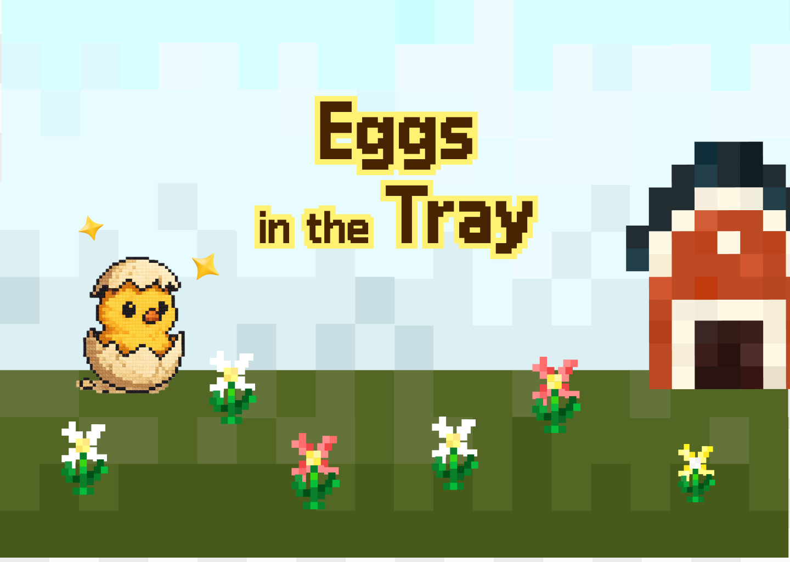
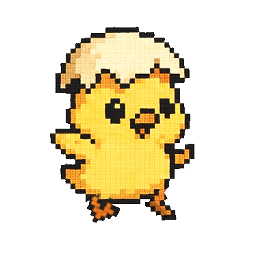
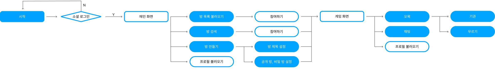
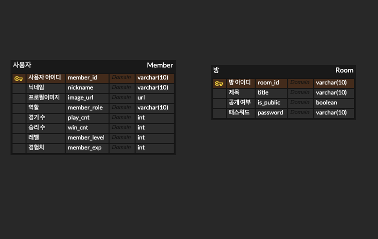
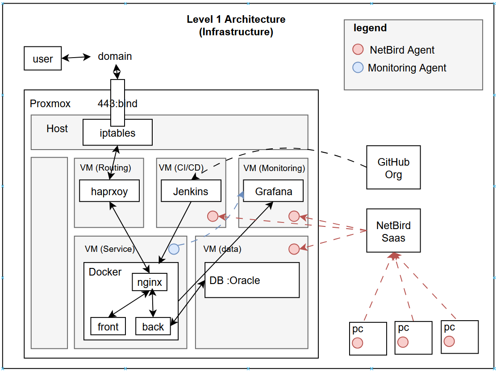
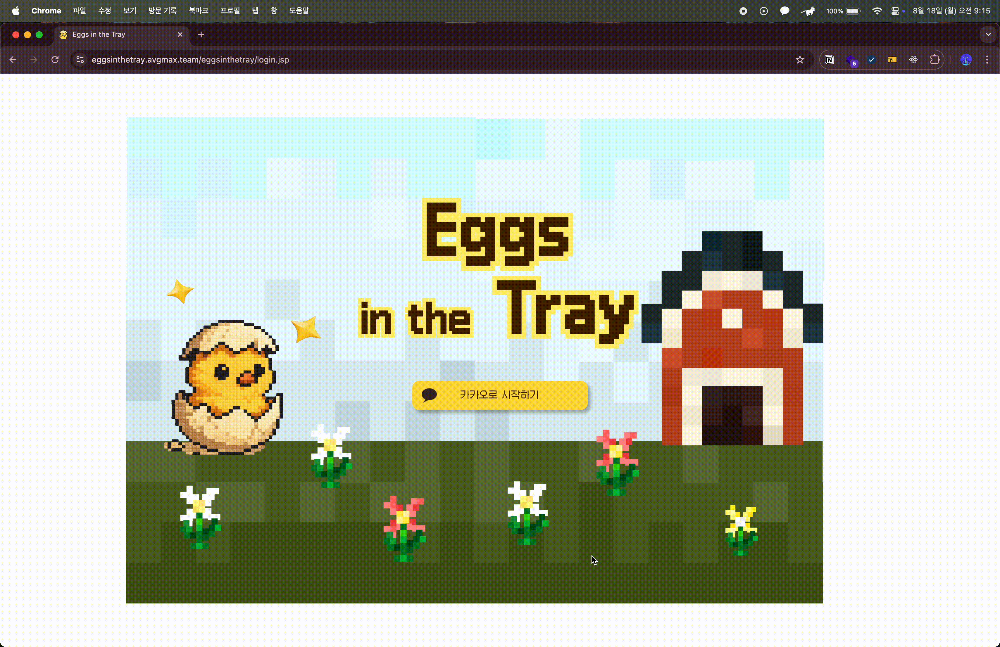
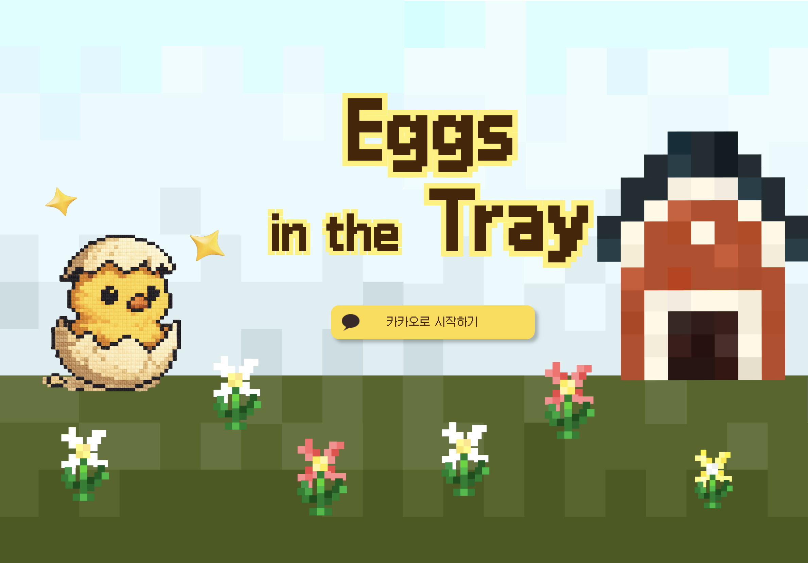
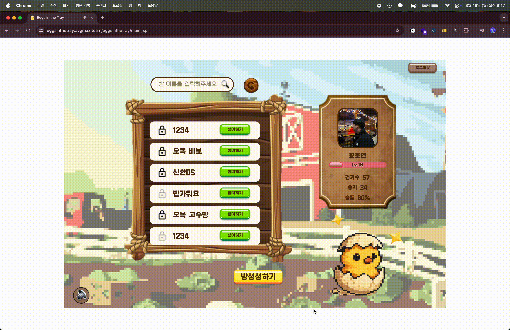
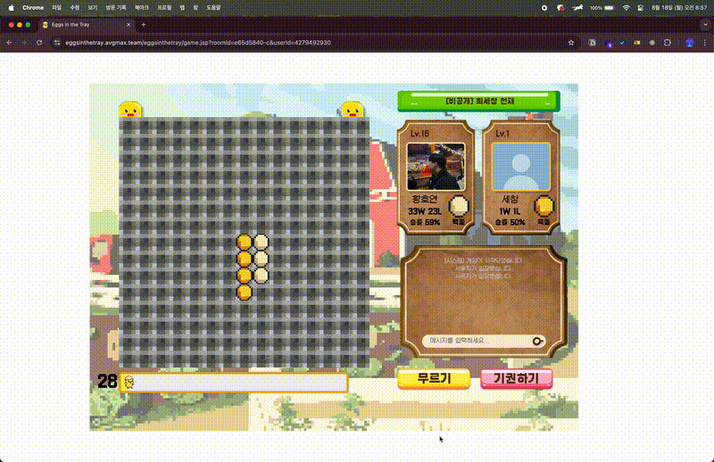
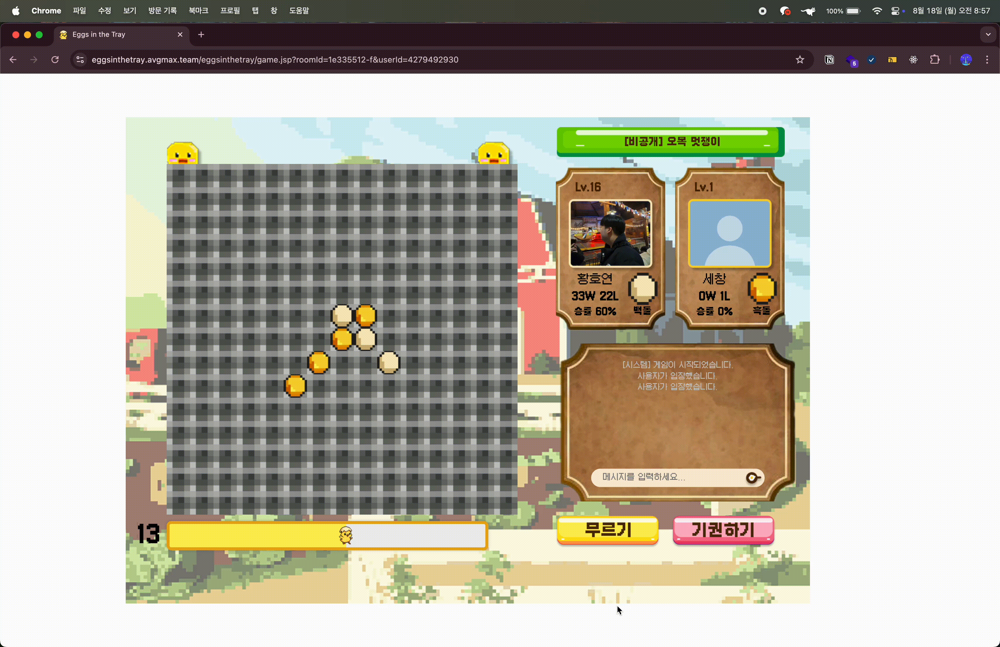

# Eggs in the Tray (Servlet & Web socket을 활용한 웹 오목 게임)

## 1. 팀원 소개 및 파트 소개

### 1-1. 팀원

| 팀장 | 팀원1 | 팀원2 | 팀원3 | 팀원4 |
| --- | --- | --- | --- | --- |
|  |  |  |  |  |
| [허재환](https://github.com/hwan001) | [장하진](https://github.com/hajin2872) | [정재웅](https://github.com/jjweidon) | [홍민우](https://github.com/Minwooh) | [황호연](https://github.com/brianhhy) |

### 1-2. 역할

- 허재환 : 아키텍처 / 인프라 리더 및 게임 풀스택 개발
- 장하진 : 게임 풀스택 개발
- 정재웅 : 개발 / 테스트 리더 및 메인, 게임 풀스택 개발
- 홍민우 : 디자인 / 기획 리더 및 로그인 풀스택 개발
- 황호연 : 메인 풀스택 개발

## 2. 프로젝트 목표

- 컨벤션, 지라, 깃 등 협업 툴과 방식에 익숙해지기
- 한 사람이 작성한 코드처럼  컨벤션 준수하기‼️
- Servlet, Web Socket 등 수업시간에 배운 기술들을 실제로 적용하면서 이해하기
- MVC 패턴의 구조를 이해하고 적용해보기‼

## 3. 서비스 기획

### 3-1. 주 사용자 타겟팅 및 디자인 반영

- 사용자 타겟 : 오목을 처음 접하거나 가볍게 즐기고 싶은 초보자층(초보의 상징인 병아리 메인 캐릭터로 활용)
- 디자인 컨셉 : 사용자를 고려한 친근한 이미지 부여 할 수 있는 컨셉 고려(도트, 귀여운 병아리)

### 3-2. 게임 스토리

- 병아리의 농장 탈출
- 게임에서 이기면 닭, 지면 치킨
- LV 0 ~ 4 : 아직 알에 있는 병아리 , LV5 ~ 9 : 알에서 나온 병아리, LV6 ~ 10 : 닭
- 실제 구현도 level에 따라 우측 하단에 다른 이미지(알을 깬 병아리, 걷는 병아리, 닭)가 보이도록 구현했다.

### 3-3. Flow chart

로그인 화면, 메인 화면, 게임 화면을 중심으로 기능을 정리했다.

## 4. ERD

Member table에 카카오 로그인을 통해 로그인 한 사용자의 정보를 저장했고, Room table에 게임이 진행되는 방에 대한 정보를 저장했다.

## 5. 인프라

인프라 써주세용

## 6.페이지 별 주요 기능

### 로그인

- **카카오 *OAuth*** 2.0 기반의 소셜 로그인 서비스 활용하여 사이트를 로그인한다.
- 프로필 이미지, 이름을 카카오로부터 받아온다.

### 메인

- DB로부터 프로필과 방 목록을 불러온다.

- 검색창을 통해 특정 방 이름을 검색한다.

- 방 만들기 버튼을 통해 오목을 진행할 방을 만든다.

### 게임
- 웹소켓을 활용해 실시간으로 두명의 유저가 게임을 진행한다.
- 30초의 시간 제한을 두고 오목을 진행한다.
- 별도의 채팅 서버를 만들어 게임 중 소통이 가능하도록 한다.
- 승 / 패에 따라 다른 화면을 출력한다.

### 승리 화면

### 패배 화면

## 7. 기술 스택

### 👩🏻‍💻 Frond-end

  
  
  

### 👨🏻‍💻 Back-end

  

### 👨🏻‍💻 Database

  

### 👨🏻‍💻 Server & CI/CD

  
  
  
  

### 👨🏻‍💻 Communication

  
  
  
  
  

